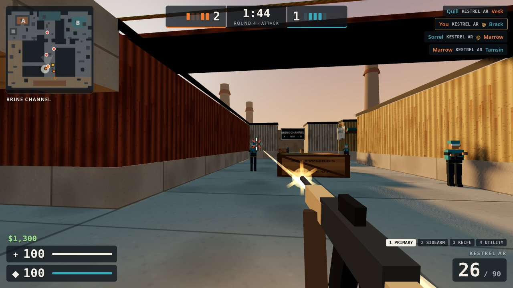

# ASHGATE: Saltworks

A round-based tactical first-person shooter for the browser, built on three.js with no build step.
Two squads of five fight over **Saltworks**, a sun-bleached brine refinery on the harbour at golden
hour. **Cinder Cell** attacks and must plant a charge on Site A (the Evaporation Pans) or Site B (the
Pump Hall); **Harbor Watch** defends, rotates, retakes and defuses. You fight alongside four bots
against five. Money carries between rounds, sides swap at the half, first to seven rounds wins.



## Play

```sh
node serve.ts          # serves game/ on http://localhost:8080
```

Open http://localhost:8080 in desktop Chrome and click **Click to play**. Everything is local: no
network requests, no fonts or images or sounds from anywhere else. Textures are painted on canvases
and every sound is synthesised with WebAudio.

| Key | Action |
| --- | --- |
| W A S D | Move (accelerates and slides to a stop) |
| Mouse / Left click | Look / fire |
| Right click | Scope (Longshore .338) |
| Shift | Walk: silent, and more accurate |
| Ctrl or C | Crouch: lower and steadier |
| Space | Jump |
| R | Reload |
| 1 2 3 4 | Primary, sidearm, knife, grenades (press 4 again to cycle) |
| E (hold) | Plant the charge on a site / defuse it |
| B | Buy menu (freeze time and the first seconds of the round) |
| Tab | Scoreboard |
| Esc | Pause and settings (mouse sensitivity, bot difficulty) |

## Features

- **Gunplay.** Hitscan against per-soldier hit zones (head sphere, torso and leg boxes) and the map;
  head, body and leg multipliers; armour penetration per weapon; damage falloff with range.
  First-shot accuracy, a cone that blooms with sustained fire, widens with run speed and in the air,
  tightens when crouched. Each weapon has a learnable recoil pattern: the bullets follow the full
  punch while the camera shows part of it. Crosshair gap is computed from the real cone.
- **Armoury.** Tern P9 sidearm, Wisp SMG, Breaker 12 shotgun, Kestrel AR, Longshore .338 marksman
  rifle (scoped), Hook knife; Frag, Brine Smoke and Glare (flash) grenades; kevlar, helmet, defuse kit.
- **Grenades.** Ballistic arcs with bounces. Frags fall off with distance and are stopped by walls,
  smoke volumes block sight for bots and players, flashes blind by how squarely you looked at them.
- **Rounds and economy.** Freeze and buy time, a 1:55 round, 3.2 s plant, 40 s fuse with a quickening
  beep, 5 s defuse (3 s with a kit). Wins by elimination, detonation, defuse or time. $800 start, kill
  rewards per weapon, win bonuses, loss streak bonus, plant bonus. Survivors keep their gear. Side
  swap at round 7, first to seven, round MVPs and a match summary.
- **Bots.** A* over the walkable grid, string-pulled into straight legs. Squad strategy: attackers
  choose a site and a style (rush, split, or a slow default that stages at the lane mouths and
  executes on the clock or on contact, smoking a defender's angle); defenders anchor holds on both
  sites and mid, rotate when attackers are seen near a site, retake and send one to defuse. Each bot
  sees through a view cone with line-of-sight rays (smoke and flashes count), hears gunfire and
  running footsteps, and switches between engage, cover (reload out of sight), chase, investigate,
  plant, defuse and throw. Reaction time, tracking error and burst control depend on difficulty, and
  bots must stop to shoot accurately, exactly like you.
- **Map.** Three lanes (Salt Yard, Brine Channel, Conveyor Row), two connectors (Short A, Pipe Alley),
  an underpass, two sites with three entrances each, a long mid sightline through the Gate. The whole
  map is one ASCII grid in `mapdata.js` that drives collision, navigation, meshes and the minimap.
- **Look.** Low west sun with PCF soft shadows, hemisphere fill, warm fog, ACES tone mapping, a
  gradient sky shader with sun glow, procedural concrete, sand, salt crust, rusted and painted
  corrugated metal, crates, brick and tiles, painted site letters and refinery signage, low-poly
  soldiers in side colours with a walk cycle and a death topple, a first-person view model with sway,
  bob, recoil kick, reload and draw animations and a muzzle flash, tracers, sparks, bullet holes.
- **HUD.** Health, armour, money, ammo, weapon slots, round clock (charge fuse once planted), scores
  with alive pips, killfeed with headshot marks, north-up minimap with spotted enemies and the charge,
  damage direction arcs, hit and headshot markers, plant/defuse progress, flash and scope overlays.

## Architecture

The simulation runs in fixed 60 Hz ticks from an accumulator and never touches the DOM or the
renderer; the renderer draws once per display frame and interpolates between the last two ticks.
The sim writes facts into a fixed ring of reusable event records that effects, audio and the HUD drain
once per frame. The whole match lives in one state object; the only randomness is a seeded RNG, so a
seed replays a match exactly. Hot paths reuse vectors, hit records, pools and typed arrays.

| Module | One job |
| --- | --- |
| `main.js` | Boot, the fixed-step loop, game flow (title, pause, buy, match end) |
| `config.js` | Every tuning number: timing, movement, rounds, money, palette |
| `state.js` | The single match state object |
| `rng.js` | Seeded random stream |
| `events.js` | Ring buffer of sim-to-presentation events |
| `mapdata.js` | The Saltworks grid, legend, spawns, holds, routes, zones |
| `collision.js` | Map boxes, per-cell index, grid-walking raycasts, body movement with step-up |
| `nav.js` | A* over walkable cells and path smoothing |
| `actors.js` | The soldier record and its hit zones |
| `weapons.js` | Weapon, grenade and gear data, buy menu layout |
| `movement.js` | Acceleration, friction, walk/crouch/jump, footsteps |
| `combat.js` | Firing, spread, recoil, hitscan, armour, kills |
| `grenades.js` | Grenade flight, frag, smoke volumes, flashes |
| `perception.js` | Sight (cone, line of sight, smoke, blindness) and hearing |
| `brain.js` | One bot's modes, steering, aim and trigger discipline |
| `strategy.js` | Squad plans, executes, rotations, post-plant and retake |
| `economy.js` | Rewards, prices, buying for players and bots |
| `rounds.js` | Round phases, plant/defuse, win conditions, MVP, half time |
| `sim.js` | One tick in a fixed order |
| `input.js` / `player.js` | Raw input / turning it into the player's intent |
| `render.js` | Camera, two-pass draw (world, then view model) |
| `world.js` / `textures.js` / `scenery.js` | Map meshes and props / canvas materials / sun, sky, horizon |
| `soldier.js` / `viewmodel.js` / `effects.js` | Bot bodies / first-person weapon / pooled effects |
| `hud.js` / `minimap.js` / `screens.js` | HUD / radar / title, buy menu, scoreboard, summary |
| `audio.js` | Synthesised positional sound |
| `settings.js` | Preferences in localStorage |
| `shots.js` | Screenshot staging, loaded only with `?shot=` |

## Screenshots

`?shot=play|buy|site|end&seed=N` runs the real game deterministically: it stages a round (score,
money, who carries the charge), plays it through the real simulation with your seat on autopilot,
and freezes on the moment. `shots.json` lists the four queries used for `screenshots/`.

## Hand-in

`node main.ts` copies `game/` and `screenshots/` to `/output` (or `MAKEFUN_OUTPUT_DIR`) and writes
`dossier.json` with the vendored make.fun library.

## License

MIT, see [LICENSE](LICENSE). three.js is MIT, vendored unchanged under `game/vendor/three/`.
